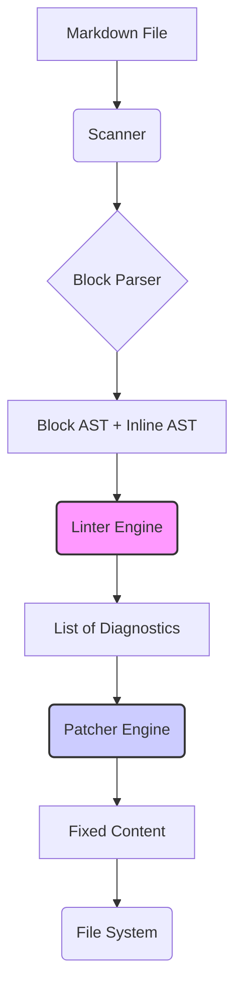

---

Title:  "mdfix — Markdown Document Fixer and Formatter"
Code:   "README"
Version: "2.0.0"
Status: "active"
Description: "CLI tool for analyzing, validating and automatically fixing Markdown documents according to predefined rules."
Owner:  "Ricci"
Layer:  "Project Documentation"
Type:   "Overview"
Document Class: "Public"
Audience: "Users, Developers, Contributors"
Canonical Language: uk
Translations: en
Created: 2026-08-02
Last Updated: 2026-10-14
Reviewers: ["AI Assistant"]
Approved By: ["Ricci"]
Related Documents: ["docs/PROJECT_STATE.md", "docs/INLINE_AST_DESIGN.md"]
Related ADRs: ["DESIGN-001"]

---

## mdfix

## Українська версія

### Призначення

`mdfix` — це CLI-інструмент для аналізу, перевірки та автоматичного виправлення Markdown-документів відповідно до визначених правил.

Проєкт використовує структурний підхід до обробки документів через побудову моделей документа та AST замість прямої текстової заміни. Основна мета — створити безпечний, розширюваний та передбачуваний інструмент для підтримки якості Markdown-документів.

### Поточний статус

**Версія:** 0.9.0  
**Статус:** Стабільний MVP (Minimum Viable Product)

**Реалізовано:**

* **Scanner:** Рекурсивний пошук `.md` файлів з фільтрацією технічних директорій (`.git`, `__pycache__`, `.pytest_cache`).
* **Parser:** Базовий блоковий парсер (Headings, Paragraphs, Lists, Tables, Code Blocks) з інтеграцією Inline Parser'а.
* **Inline AST:** Повноцінна підтримка вкладених елементів (`Strong`, `Emphasis`, `Links`) всередині блоків тексту.
* **Diagnostics Engine:** Модель даних `Diagnostic`, енум `Severity` та рушій правил `Linter`.
* **Patcher Engine:** Логіка застосування виправлень (`apply_fixes`) з підтримкою single-line та multi-line замін (bottom-up order).
* **Rule Registry:** Централізоване керування списком активних правил (`registry.py`).
* **CLI Commands:** Доступні команди `scan`, `version`, `lint` (перевірка) та `fix` (автофікс з `--dry-run`).
* **Supported Rules:**
  * MD001: Heading Level Skip
  * MD009: Trailing Whitespace (Auto-fix supported)
  * MD047: Newline at EOF (Auto-fix supported)
  * MD055: Table Format (Auto-fix supported via multi-line patching)
* **Tests:** Понад 150 автоматизованих тестів (Unit & Integration).

### Архітектура

Поточний pipeline обробки:



1. **Scanner:** Знаходить файли.
2. **Parser:** Читає файл і будує дерево блокових елементів (`Document.elements`) з інтегрованими inline-структурами.
3. **Linter:** Пройдеться по готовому AST і застосовує зареєстровані правила, генеруючи список помилок (`List[Diagnostic]`). Кожен діагноз може містити пропозицію виправлення (`suggestion_diff`).
4. **Patcher:** Приймає сирого контенту файлу та список діагностик. Застосовує зміни "знизу вгору" (bottom-up), щоб не порушити індекси рядків при множинних змінах. Підтримує заміну цілих блоків (наприклад, таблиць).
5. **Writer:** Записує виправлений контент назад у файл (якщо режим не `--dry-run`).

Детальний опис дизайну Inline AST: [docs/INLINE_AST_DESIGN.md](docs/INLINE_AST_DESIGN.md)

### Дорожня карта (Roadmap)

* **Milestone 1 (Completed):** Ядро діагностики. Правила MD0xx. Команда `lint`.
* **Milestone 2 (Completed):** Система автофіксів (`mdfix fix`). Інтеграція форматера таблиць. Мультилайновий патчер.
* **Milestone 3 (Current v0.9.0):** Розширення правил (MD047, MD055), рефакторинг Registry, стабілізація ядра.
* **Milestone 4 (Planned):**
  * Unified Diff View у `fix --dry-run`.
  * Конфігурація через `pyproject.toml`.
  * JSON Output для CI/CD.
  * Додаткові правила (Lists, Code Blocks).
* **Milestone 5+:** Стабілізація, CI/CD Pipeline, реліз v1.0.0-beta.

### Встановлення

Розробницьке встановлення:

```bash
git clone https://github.com/ricci-git/mdfix.git
cd mdfix
python -m venv .venv
source .venv/bin/activate  # Linux/macOS
# .venv\Scripts\activate   # Windows
pip install -e ".[dev]"
```

### Використання

#### 1. Перевірка документів (Lint)

Аналізує файли та виводить список порушень у консоль:

```bash
# Перевірити один файл
mdfix lint README.md

# Перевірити всю директорію рекурсивно
mdfix lint docs/
```

Приклад виводу:

```text
Found 2 issue(s):
docs/example.md:10:1 [MD009] Trailing whitespace found
docs/example.md:25:1 [MD055] Table format issue detected
```

#### 2. Автоматичне виправлення (Fix)

Виправляє помилки, які мають підтримку автофіксу.

⚠️ **Рекомендація:** Спочатку завжди використовуйте `--dry-run`, щоб побачити, що буде змінено, не записуючи дані на диск.

```bash
# Перегляд змін (без запису)
mdfix fix docs/ --dry-run

# Застосування виправлень
mdfix fix docs/
```

#### 3. Інші команди

```bash
# Показати версію
mdfix version

# Просканувати структуру директорії
mdfix scan .
```

### Розробка

Запуск тестів:

```bash
pytest
```

Перевірка стилю коду:

```bash
ruff check .
```

Автофікс стилю:

```bash
ruff check --fix .
```

### Структура проєкту

```text
mdfix/
 ├── cli.py              # Інтерфейс командного рядка (Typer)
 ├── document.py         # Модель Document
 ├── elements.py         # Моделі блокових елементів AST
 ├── diagnostics.py      # Модель Diagnostic та Severity
 ├── linter.py           # Рушій виконання правил
 ├── patcher.py          # Логіка застосування виправлень (Single/Multi-line)
 ├── parser.py           # Головний парсер (Block + Inline integration)
 ├── inline_parser.py    # Парсер inline-токенів
 ├── inline_tokens.py    # Лексичні токени
 ├── inline_elements.py  # Моделі inline-елементів AST
 ├── table_formatter.py  # Модуль форматування таблиць
 ├── scanner.py          # Пошук файлів
 ├── registry.py         # Реєстр активних правил
 └── version.py          # Версія пакета
 tests/
 ├── test_diagnostics.py
 ├── test_linter.py
 ├── test_patcher.py     # Тести для механізму фіксів
 ├── test_cli_lint.py    # Тести для CLI lint
 ├── test_cli_fix.py     # Тести для CLI fix
 ├── test_scanner.py
 ├── test_table_formatter.py
 └── rules/              # Тести конкретних правил
     ├── test_md001_heading_skip.py
     ├── test_md009_trailing_whitespace.py
     ├── test_md047_newline_eof.py
     └── test_md055_table_format.py
```

### Принципи дизайну

* **Small isolated components:** Кожен модуль має чітку зону відповідальності.
* **Test-driven development (TDD):** Спочатку тест, потім код.
* **Explicit document structure:** Робота зі структурованими даними (AST), а не сирими рядками.
* **Safe automated modifications:** Будь-які зміни мають бути попередньо переглянуті (`--dry-run`) або гарантовано ідемпотентними.
* **Extensible validation rules:** Легкість додавання нових правил літингу через Registry.
* **Documentation as code:** Документація синхронізується зі станом репозиторію.

### Ліцензія

MIT License

---

## English Translation

### Purpose

`mdfix` is a CLI tool for analyzing, validating, and automatically fixing Markdown documents according to predefined rules.

The project uses a structured document processing approach based on document models and AST instead of direct text replacement. The main goal is to provide a safe, extensible, and predictable tool for maintaining Markdown document quality.

### Current Status

**Version:** 0.9.0  
**Status:** Stable MVP (Minimum Viable Product)

**Implemented:**

* **Scanner:** Recursive search for `.md` files with filtering of technical directories (`.git`, `__pycache__`, `.pytest_cache`).
* **Parser:** Basic block parser (Headings, Paragraphs, Lists, Tables, Code Blocks) with integrated Inline Parser.
* **Inline AST:** Full support for nested elements (`Strong`, `Emphasis`, `Links`) inside text blocks.
* **Diagnostics Engine:** Data model `Diagnostic`, enum `Severity`, and rule engine `Linter`.
* **Patcher Engine:** Logic for applying fixes (`apply_fixes`) supporting single-line and multi-line replacements (bottom-up order).
* **Rule Registry:** Centralized management of active rules list (`registry.py`).
* **CLI Commands:** Available commands `scan`, `version`, `lint` (analysis), and `fix` (auto-fix with `--dry-run`).
* **Supported Rules:**
  * MD001: Heading Level Skip
  * MD009: Trailing Whitespace (Auto-fix supported)
  * MD047: Newline at EOF (Auto-fix supported)
  * MD055: Table Format (Auto-fix supported via multi-line patching)
* **Tests:** Over 150 automated tests (Unit & Integration).

### Architecture

Current processing pipeline:

-*(See Mermaid diagram above)*

1. **Scanner:** Finds files.
2. **Parser:** Reads file and builds tree of block elements (`Document.elements`) with integrated inline structures.
3. **Linter:** Iterates over the ready AST and applies registered rules, generating a list of errors (`List[Diagnostic]`). Each diagnostic may contain a fix suggestion (`suggestion_diff`).
4. **Patcher:** Takes raw file content and list of diagnostics. Applies changes "bottom-up" to preserve line indices during multiple edits. Supports replacing entire blocks (e.g., tables).
5. **Writer:** Writes fixed content back to file (if not in `--dry-run` mode).

Detailed design of Inline AST: [docs/INLINE_AST_DESIGN.md](docs/INLINE_AST_DESIGN.md)

### Roadmap

* **Milestone 1 (Completed):** Diagnostics Core. Rules MD0xx. Command `lint`.
* **Milestone 2 (Completed):** Auto-fix system (`mdfix fix`). Table formatter integration. Multi-line patcher.
* **Milestone 3 (Current v0.9.0):** Expanded rules (MD047, MD055), Registry refactoring, core stabilization.
* **Milestone 4 (Planned):**
  * Unified Diff View in `fix --dry-run`.
  * Configuration via `pyproject.toml`.
  * JSON Output for CI/CD.
  * Additional rules (Lists, Code Blocks).
* **Milestone 5+:** Stabilization, CI/CD Pipeline, release v1.0.0-beta.

### Installation

Development installation:

```bash
git clone https://github.com/ricci-git/mdfix.git
cd mdfix
python -m venv .venv
source .venv/bin/activate  # Linux/macOS
# .venv\Scripts\activate   # Windows
pip install -e ".[dev]"
```

### Usage

#### 1. Analyze Documents (Lint)

Analyzes files and outputs a list of violations to the console:

```bash
# Check a single file
mdfix lint README.md

# Recursively check a directory
mdfix lint docs/
```

Example output:

```text
Found 2 issue(s):
docs/example.md:10:1 [MD009] Trailing whitespace found
docs/example.md:25:1 [MD055] Table format issue detected
```

#### 2. Automatic Fixing (Fix)

Fixes errors that have auto-fix support.

⚠️ **Recommendation:** Always use `--dry-run` first to see what will change without writing to disk.

```bash
# Preview changes (no write)
mdfix fix docs/ --dry-run

# Apply fixes
mdfix fix docs/
```

#### 3. Other Commands

```bash
# Show version
mdfix version

# Scan directory structure
mdfix scan .
```

### Development

Run tests:

```bash
pytest
```

Check code style:

```bash
ruff check .
```

Auto-fix style:

```bash
ruff check --fix .
```

### Project Structure

-*(Same as Ukrainian section)*

### Design Principles

* **Small isolated components:** Each module has a clear area of responsibility.
* **Test-driven development (TDD):** Test first, then code.
* **Explicit document structure:** Working with structured data (AST), not raw strings.
* **Safe automated modifications:** Any changes must be previewed or guaranteed idempotent.
* **Extensible validation rules:** Ease of adding new linting rules via Registry.
* **Documentation as code:** Documentation synchronizes with repository state.

### License

MIT License

---

### Version History

| Version | Date       | Author      | Changes                                                                                                                                    |
| ------- | ---------- | ----------- | ------------------------------------------------------------------------------------------------------------------------------------------ |
| 2.0.0   | 2026-10-14 | Ricci/AI    | Major update to reflect v0.9.0 state. Added Linter/Patcher details, updated rules list, clarified architecture, added EN translation sync. |
| 1.0.0   | 2026-10-07 | Ricci/AI    | Initial public README reflecting v0.8.3 state.                                                                                             |
| 0.7.0   | 2026-08-02 | Team        | Initial public README.                                                                                                                     |
