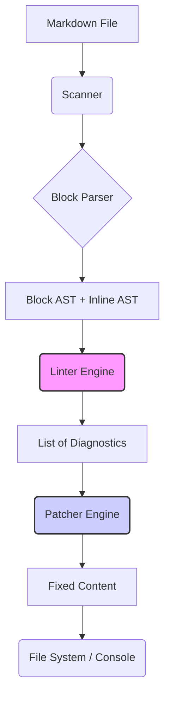

## Стан проєкту mdfix

## 1. Загальний статус

**Версія:** v0.9.0  
**Статус:** Стабільний MVP (Minimum Viable Product)  
**Дата релізу:** 2026-10-15

Проєкт має повноцінний конвеєр обробки Markdown-документів: від сканування файлів до автоматичного виправлення помилок форматування. Система готова до використання у реальних проєктах та інтеграції в CI/CD пайплайни.

### Ключові можливості v0.9.0

* **Лінтинг:** Виявлення порушень стандартів форматування (Markdownlint-compatible rules).
* **Автофікс:** Безпечне виправлення знайдених помилок із підтримкою багаторядкових блоків (таблиці).
* **Конфігурація:** Гнучке налаштування через `[tool.mdfix]` у `pyproject.toml`.
* **Інструменти CLI:** Команди `lint`, `fix` (з `--dry-run` та Unified Diff), `scan`, `version`.
* **Формати виводу:** Текст (для людини) та JSON (для машин/CI).
* **Інфраструктура:** Автоматизований CI/CD pipeline на GitHub Actions.

## 2. Архітектурний огляд

### 2.1 Конвеєр обробки (Pipeline)



### 2.2 Основні компоненти

| Компонент | Файл | Відповідальність | Статус |
| :--- | :--- | :--- | :--- |
| **Scanner** | `scanner.py` | Рекурсивний пошук `.md` файлів, фільтрація технічних директорій (`.git`, `__pycache__`). | ✅ Stable |
| **Parser** | `parser.py`, `inline_parser.py` | Побудова Block AST та Inline AST. Підтримка вкладених елементів. | ✅ Stable |
| **Linter** | `linter.py` | Рушій виконання правил. Приймає AST, повертає список `Diagnostic`. | ✅ Stable |
| **Patcher** | `patcher.py` | Застосування виправлень (`suggestion_diff`) до сирого тексту. Bottom-up логіка для мультилайнів. | ✅ Stable |
| **Registry** | `rules/registry.py` | Централізоване керування списком активних правил. Підтримка динамічної фільтрації (disable). | ✅ New in v0.9.0 |
| **Config** | `config.py` | Читання налаштувань з `pyproject.toml`. | ✅ New in v0.9.0 |
| **CLI** | `cli.py` | Інтерфейс командного рядка (Typer). Інтеграція всіх компонентів. | ✅ Stable |

## 3. База правил (Rules Inventory)

Наразі реалізовано та активовано за замовчуванням 6 правил, сумісних зі стандартом `markdownlint`:

| ID | Назва | Опис | Автофікс | Складність реалізації |
| :--- | :--- | :--- | :--- | :--- |
| **MD001** | Heading Level Skip | Забороняє пропускати рівні заголовків (H1 -> H3). | ❌ Manual | Low |
| **MD009** | Trailing Whitespace | Видаляє зайві пробіли/табуляції в кінці рядків. | ✅ Yes | Low |
| **MD018** | Heading Space | Вимагає пробіл після хеша в ATX-заголовках (`#Title` -> `# Title`). | ✅ Yes | Low |
| **MD030** | List Spacing | Вимагає пробіл після маркера списку (`-Item` -> `- Item`). | ✅ Yes | Low |
| **MD047** | Newline at EOF | Гарантує наявність одного символу нового рядка в кінці файлу. | ✅ Yes | Low |
| **MD055** | Table Format | Нормалізує форматування таблиць (вирівнювання колонок, розділювачі). | ✅ Yes | High (Multi-line) |

*Детальний план розширення бази правил до ~20+ описаний у `docs/BACKLOG.md`.*

## 4. Технічний борг та обмеження

### 4.1 Обмеження парсингу

* **Edge Cases:** Складні конструкції Markdown (footnotes, HTML-in-MD, complex escapes) можуть парситися некоректно або не підтримуватися поки що.
* **Inline Depth:** Глибока вкладеність inline-елементів (наприклад, `**bold *italic* bold**`) підтримується базово, але може потребувати оптимізації для дуже великих документів.

### 4.2 Продуктивність

* **Sequential Processing:** Наразі файли обробляються послідовно. Для директорій з тисячами файлів це може бути повільно. Планується додавання паралельної обробки в Milestone 6.

### 4.3 Тестове покриття

* **Unit Tests:** Покриття ядра високе (>160 тестів).
* **Integration Tests:** Покриття CLI команд хороше.
* **Property-Based Testing:** Відсутнє. Планується додати для перевірки стабільності парсера на випадкових вхідних даних (Milestone 6+).

## 5. Дорожня карта (Roadmap Summary)

Повний стратегічний план описаний у `docs/ROADMAP.md`. Поточний фокус:

* **✅ Milestone 0-4 (Завершено):** Ядро, автофікси, конфігурація, CI/CD, базові правила.
* **🚀 Milestone 5 (In Progress):** Масштабування бази правил (Group A: Easy Wins). Ціль: v0.10.0-beta.
* **🔮 Milestone 6 (Planned):** Оптимізація продуктивності, DX (редактори), Prettier-like форматування.
* **🏁 Milestone 7 (Planned):** Реліз v1.0.0, PyPI publication.

## 6. Інструкція для розробника

### Локальний запуск

```bash
pip install -e ".[dev]"
pytest -q          # Запуск усіх тестів
ruff check .       # Перевірка стилю коду
python -m mdfix lint docs/  # Літинг власної документації
```

### Додавання нового правила

1. Створіть файл `mdfix/rules/mdXXX_name.py`.
2. Реалізуйте клас, успадкований від `Rule`.
3. Додайте тест у `tests/rules/test_mdXXX_name.py`.
4. Зареєструйте правило у `mdfix/rules/registry.py` у функції `get_all_rules()`.
5. Запустіть тести.

---

## English Translation

## Project State of mdfix

## 1. General Status

**Version:** v0.9.0  
**Status:** Stable MVP (Minimum Viable Product)  
**Release Date:** 2026-10-15

The project has a complete Markdown document processing pipeline: from file scanning to automatic formatting error fixing. The system is ready for use in real projects and integration into CI/CD pipelines.

### Key Features v0.9.0

* **Linting:** Detection of formatting standard violations (Markdownlint-compatible rules).
* **Auto-fix:** Safe correction of found errors with support for multi-line blocks (tables).
* **Configuration:** Flexible setup via `[tool.mdfix]` in `pyproject.toml`.
* **CLI Tools:** Commands `lint`, `fix` (with `--dry-run` & Unified Diff), `scan`, `version`.
* **Output Formats:** Text (for humans) and JSON (for machines/CI).
* **Infrastructure:** Automated CI/CD pipeline on GitHub Actions.

## 2. Architectural Overview

-*(Same diagram as above)*

### 2.2 Main Components

| Component | File | Responsibility | Status |
| :--- | :--- | :--- | :--- |
| **Scanner** | `scanner.py` | Recursive search for `.md` files, filtering technical directories. | ✅ Stable |
| **Parser** | `parser.py`, `inline_parser.py` | Building Block AST and Inline AST. Supports nested elements. | ✅ Stable |
| **Linter** | `linter.py` | Rule execution engine. Accepts AST, returns list of `Diagnostic`. | ✅ Stable |
| **Patcher** | `patcher.py` | Applying fixes (`suggestion_diff`) to raw text. Bottom-up logic for multi-lines. | ✅ Stable |
| **Registry** | `rules/registry.py` | Centralized management of active rules list. Dynamic filtering support. | ✅ New in v0.9.0 |
| **Config** | `config.py` | Reading settings from `pyproject.toml`. | ✅ New in v0.9.0 |
| **CLI** | `cli.py` | Command line interface (Typer). Integration of all components. | ✅ Stable |

## 3. Rules Inventory

Currently implemented and enabled by default are 6 rules compatible with the `markdownlint` standard:

| ID | Name | Description | Auto-fix | Complexity |
| :--- | :--- | :--- | :--- | :--- |
| **MD001** | Heading Level Skip | Forbids skipping heading levels (H1 -> H3). | ❌ Manual | Low |
| **MD009** | Trailing Whitespace | Removes extra spaces/tabs at end of lines. | ✅ Yes | Low |
| **MD018** | Heading Space | Requires space after hash in ATX headings (`#Title` -> `# Title`). | ✅ Yes | Low |
| **MD030** | List Spacing | Requires space after list marker (`-Item` -> `- Item`). | ✅ Yes | Low |
| **MD047** | Newline at EOF | Guarantees presence of one newline character at end of file. | ✅ Yes | Low |
| **MD055** | Table Format | Normalizes table formatting (column alignment, separators). | ✅ Yes | High (Multi-line) |

*Detailed plan for expanding rule base to ~20+ described in `docs/BACKLOG.md`.*

## 4. Technical Debt & Limitations

### 4.1 Parsing Limitations

* **Edge Cases:** Complex Markdown constructs (footnotes, HTML-in-MD, complex escapes) may be parsed incorrectly or unsupported for now.
* **Inline Depth:** Deep nesting of inline elements is supported basically but may require optimization for very large documents.

### 4.2 Performance

* **Sequential Processing:** Currently files are processed sequentially. For directories with thousands of files this can be slow. Parallel processing planned for Milestone 6.

### 4.3 Test Coverage

* **Unit Tests:** Core coverage is high (>160 tests).
* **Integration Tests:** Good CLI command coverage.
* **Property-Based Testing:** Missing. Planned to add for parser stability verification on random input data (Milestone 6+).

## 5. Roadmap Summary

Full strategic plan described in `docs/ROADMAP.md`. Current focus:

* **✅ Milestone 0-4 (Done):** Core, auto-fixes, configuration, CI/CD, basic rules.
* **🚀 Milestone 5 (In Progress):** Scaling rule base (Group A: Easy Wins). Target: v0.10.0-beta.
* **🔮 Milestone 6 (Planned):** Performance optimization, DX (editors), Prettier-like formatting.
* **🏁 Milestone 7 (Planned):** Release v1.0.0, PyPI publication.

## 6. Developer Instructions

### Local Run

```bash
pip install -e ".[dev]"
pytest -q          # Run all tests
ruff check .       # Check code style
python -m mdfix lint docs/  # Lint own documentation
```

### Adding a New Rule

1. Create file `mdfix/rules/mdXXX_name.py`.
2. Implement class inheriting from `Rule`.
3. Add test in `tests/rules/test_mdXXX_name.py`.
4. Register rule in `mdfix/rules/registry.py` in function `get_all_rules()`.
5. Run tests.

---

### Version History

| Version | Date       | Author      | Changes                                                                 |
| ------- | ---------- | ----------- | ----------------------------------------------------------------------- |
| 3.0.0   | 2026-10-15 | Ricci/AI    | Major update to reflect v0.9.0 state. Added Registry/Config details, updated rules list, clarified architecture, added EN translation sync. Removed obsolete Milestone 0 references. |
| 2.1     | 2026-10-07 | Ricci/AI    | Added Milestone 0 priorities, standardized metadata, clarified roadmap. |
| 2.0     | 2026-10-07 | Ricci       | Updated state for v0.8.3.                                               |
| 1.0     | 2026-08-02 | Team        | Initial project state tracking.                                         |
